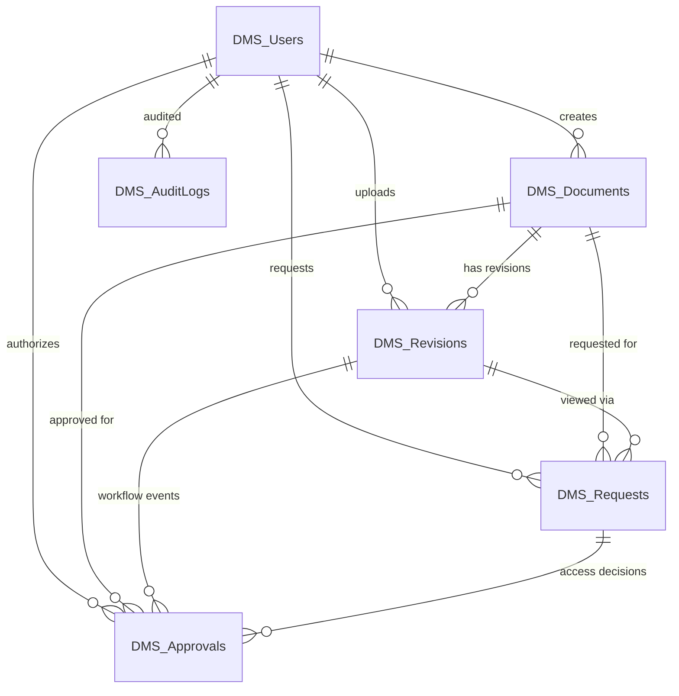

# Document Management System (DMS)

> **Enterprise Controlled PDF Document Management & Audit System**  
> Built strictly according to the **System Requirements Specification (Version 1.0, 30 October 2026)**.

---

## 1. Technology Stack

- **Framework**: ASP.NET Core MVC (`net10.0`)
- **Language**: C# 13 with Nullable Reference Types, Zero Magic Strings, and Global Anti-Forgery
- **Database**: Microsoft SQL Server with Entity Framework Core
- **Frontend**: HTML5, CSS3, Bootstrap 5.3, Bootstrap Icons 1.11, Vanilla JavaScript (Fully Responsive for Mobile, Tablet, and Desktop)
- **PDF Extraction**: Native .NET [PdfPig](https://github.com/UglyToad/PdfPig) for first-page text & metadata parsing (no third-party cloud dependency)
- **Security**: PBKDF2 Adaptive Password Hasher, SHA-256 Checksums, One-Time View Session Tokens, Server-Side Authorization & Step-Up Password Re-verification
- **Monitoring**: Built-in `/health` diagnostic probe for load balancers and container orchestrators

---

## 2. Configuration System (Why there is no `.env` file)

In **ASP.NET Core**, configuration does not use a Node/Python `.env` file. Instead, .NET provides an enterprise configuration provider that loads configuration hierarchically from:

1. `appsettings.json` (Base settings)
2. `appsettings.{Environment}.json` (e.g., `appsettings.Development.json` or `appsettings.Production.json`)
3. **Operating System Environment Variables** (Overrides files without modifying code)
4. **Command-Line Arguments**

### How to set configurations via Environment Variables
Any setting in `appsettings.json` can be overridden by an environment variable using **double underscores (`__`)**:

| `appsettings.json` Key | Environment Variable Equivalent | Description |
|---|---|---|
| `ConnectionStrings:DmsConnection` | `ConnectionStrings__DmsConnection` | SQL Server connection string |
| `DMS:StoragePath` | `DMS__StoragePath` | Controlled file system directory for PDFs |
| `DMS:ViewingSessionMinutes` | `DMS__ViewingSessionMinutes` | Single-session token expiration time (default: 30) |
| `DMS:CookieExpireHours` | `DMS__CookieExpireHours` | Authentication session timeout (default: 8) |
| `DMS:MaxFailedLoginAttempts` | `DMS__MaxFailedLoginAttempts` | Failed login attempt threshold before lockout (default: 5) |
| `DMS:LockoutMinutes` | `DMS__LockoutMinutes` | Lockout duration in minutes (default: 15) |
| `DMS:InitialAdmin:SalaryCode` | `DMS__InitialAdmin__SalaryCode` | Initial admin salary code (default: `ADMIN001`) |
| `DMS:InitialAdmin:DefaultPassword` | `DMS__InitialAdmin__DefaultPassword` | Initial admin password (default: `Admin@123`) |

---

## 3. SQL Server Connection Guide

The connection string is configured in [`appsettings.json`](file:///d:/download/project/.net%20project/DMS/appsettings.json) or [`appsettings.Production.json`](file:///d:/download/project/.net%20project/DMS/appsettings.Production.json):

```json
{
  "ConnectionStrings": {
    "DmsConnection": "Server=(localdb)\\mssqllocaldb;Database=DMS_DB;Trusted_Connection=True;MultipleActiveResultSets=true;TrustServerCertificate=True"
  }
}
```

### Supported SQL Server Connection Strings

Choose the configuration that matches your environment:

#### A. Microsoft SQL Server LocalDB (Default Development)
*Pre-installed with Visual Studio or .NET tools on Windows:*
```text
Server=(localdb)\mssqllocaldb;Database=DMS_DB;Trusted_Connection=True;MultipleActiveResultSets=true;TrustServerCertificate=True
```

#### B. SQL Server Express (Local Machine)
*If you installed SQL Server Express Edition:*
```text
Server=localhost\SQLEXPRESS;Database=DMS_DB;Trusted_Connection=True;TrustServerCertificate=True
```

#### C. SQL Server Developer / Standard / Enterprise (Windows Authentication)
*Using current Windows domain or local account:*
```text
Server=localhost;Database=DMS_DB;Trusted_Connection=True;TrustServerCertificate=True
```

#### D. SQL Server with Username & Password (SQL Server Authentication)
*Standard production setup with SQL credentials:*
```text
Server=localhost,1433;Database=DMS_DB;User Id=dms_user;Password=YourStrongPasswordHere!;TrustServerCertificate=True
```

#### E. Remote Company Database / IIS Intranet VM
*Connecting across internal DNS / enterprise network with TLS encryption:*
```text
Server=sqlserver.corp.local,1433;Database=DMS_PROD_DB;User Id=dms_svc;Password=CompanyPassword123!;Encrypt=True;TrustServerCertificate=False
```

### Setting the Connection String via Terminal (Without editing files)

#### In Windows PowerShell:
```powershell
$env:ConnectionStrings__DmsConnection = "Server=localhost;Database=DMS_DB;User Id=sa;Password=YourPass!;TrustServerCertificate=True"
cd "DMS"
dotnet run
```

#### In Windows CMD:
```cmd
set ConnectionStrings__DmsConnection=Server=localhost;Database=DMS_DB;User Id=sa;Password=YourPass!;TrustServerCertificate=True
cd DMS
dotnet run
```

#### In Linux / Docker / systemd:
```bash
export ConnectionStrings__DmsConnection="Server=db.local;Database=DMS_DB;User Id=sa;Password=YourPass!;TrustServerCertificate=True"
cd DMS
dotnet run
```

---

## 4. Database Schema: Exactly Six Application Tables

Per Section 5 of the design specification, the application enforces **exactly six tables** in Microsoft SQL Server:



1. **`DMS_Users`**: SalaryCode (`UNIQUE`, `NOT NULL`), EmployeeName, PasswordHash (PBKDF2), AccessRole (`Admin` / `QA` / `Plant`), IsActive, FailedLoginAttempts, LockedUntil.  
   *(Strictly conforms to Rule #8: No Plant, Unit, or Department columns).*
2. **`DMS_Documents`**: DocumentName, SerialNumber, Plant, DocumentType, Unit, Category, MaterialNumber, MaterialType, CurrentRevisionID, CreatedBy, CreatedAt.  
   *(Composite unique index on `Plant + SerialNumber`. Conforms to Rule #9: No Action column).*
3. **`DMS_Revisions`**: DocumentID, RevisionNumber, FileName, FileLocation, FileHash (SHA-256), Status (`Pending` / `Review` / `Approved` / `Active` / `Obsolete` / `Rejected`), UploadedBy, UploadedAt, EffectiveAt, ObsoleteAt.  
   *(Composite unique index on `DocumentID + RevisionNumber`).*
4. **`DMS_Requests`**: DocumentID, RevisionID, RequestedBy, RequestedAt, Status (`Pending` / `Approved` / `Rejected` / `Viewing` / `Consumed` / `Expired`), ApprovedBy, ApprovedAt, ViewTokenHash (SHA-256), ViewStartedAt, ViewExpiresAt, Remarks.
5. **`DMS_Approvals`**: DocumentID, RevisionID, RequestID, WorkflowType (`Review` / `DocumentApproval` / `AccessApproval` / `Issue`), Decision (`Approved` / `Rejected` / `Returned` / `Issued`), PerformedBy, PerformedAt, ReauthenticatedAt, Remarks.
6. **`DMS_AuditLogs`**: UserID, ActionType, DocumentID, RequestID, ActionAt, IPAddress, Details.

---

## 5. Architecture & Production Readiness

### Zero Hardcoded Values
All application constants are strongly-typed and centralized:
- **Constants Class (`DmsConstants.cs`)**:
  - `DmsRoles`: `Admin`, `QA`, `Plant`, `AdminOrQA`, `AllRoles`
  - `RevisionStatus`: `Pending`, `Review`, `Active`, `Rejected`, `Obsolete`
  - `RequestStatus`: `Pending`, `Approved`, `Rejected`, `Viewing`, `Consumed`, `Expired`
  - `WorkflowTypes`: `Review`, `DocumentApproval`, `AccessApproval`, `Issue`
  - `DmsClaimTypes`: `UserID`, `SalaryCode`
  - `DmsAuthDefaults`: `DmsCookieAuth`, `DMS.Auth`, `DMS.Session`, `DMS_Storage`
- **Application Configuration (`DmsSettings.cs`)**:
  - Bound via `IOptions<DmsSettings>` from the `"DMS"` section of `appsettings.json`
  - Helper method `GetEffectiveStoragePath()` resolves custom or default root directory seamlessly

### Error Handling & Health Monitoring
- **Production Error Controller (`/Error` and `/Error/{statusCode}`)**:
  - User-friendly error cards matching the DMS design theme
  - Custom handlers for 400 (Bad Request), 403 (Forbidden), 404 (Not Found), 500 (Internal Error)
  - Displays a unique Tracking Request ID (`HttpContext.TraceIdentifier`) for fast log correlation
  - Never leaks sensitive stack traces or database schema details to clients
- **Health Check Probe (`/health`)**:
  - Returns `HTTP 200 Healthy` for monitoring systems, load balancers, and Docker container healthchecks

---

## 6. Default Accounts for Testing

When the application boots for the first time, it automatically creates the database, applies all schema migrations, and seeds the initial administrator account:

| Account | Role | Salary Code | Password | Allowed Activities |
|---|---|---|---|---|
| **System Administrator** | `Admin` | `ADMIN001` | `Admin@123` | User Master CRUD, active account controls |
| **QA Officer** | `QA` | `QA001` | `Password123!` | Upload & Verify PDFs, Review, Approve, Access Requests, Issue |
| **Plant Operator** | `Plant` | `PLANT001` | `Password123!` | Browse Document Master, Request Access, Single-Session View |

*(Additional accounts can be registered anytime from the Admin User Master screen).*

---

## 7. How to Run the Project

### Prerequisites
- [.NET 10.0 SDK](https://dotnet.microsoft.com/download)
- Microsoft SQL Server (LocalDB, SQL Express, or standard SQL Server)

### Running from Command Line
```powershell
# Navigate to the project directory
cd "d:\download\project\.net project\DMS"

# Restore dependencies
dotnet restore

# Run database migration (runs automatically on app startup as well)
dotnet ef database update

# Start web application
dotnet run --urls "http://localhost:5000"
```

Open your browser and navigate to: **`http://localhost:5000`**

---

## 8. Screen Walkthrough & Responsive UI

The UI is built with **Bootstrap 5.3** and custom CSS:
- **Desktop (`>= 768px`)**: Persistent dark sidebar navigation, categorized into Document and Workflow sections.
- **Mobile / Tablet (`< 768px`)**: Top navbar with a hamburger menu that triggers a modern Bootstrap **Offcanvas** navigation drawer.
- **Tables**: All tables wrapped in `.table-responsive` to prevent layout breaking on mobile devices.
- **Modals**: All action modals are rendered outside table markup for accessibility and backdrop focus compliance.

### The 10 Application Screens:

1. **Login** (`/Account/Login`): Salary-code authentication with adaptive password hashing, rate limiting, and lockout safeguards.
2. **Dashboard** (`/Dashboard`): Role-aware dashboard with responsive cards showing pending workload items.
3. **User Master** (`/User`): Admin screen for employee management with instant role assignment and account activation toggling.
4. **Document Master** (`/Document`): Search and filter active documents by plant, type, or category. Action buttons are derived dynamically from role.
5. **Upload & Verify** (`/Upload`): QA PDF upload. Inspects the first page, validates signature `%PDF-`, and parses field labels into an editable confirmation form.
6. **Review** (`/Review`): First-stage QA workflow for reviewing newly uploaded revisions before document approval.
7. **Approval** (`/Approval`): Final approval stage. **Requires QA password re-verification modal**; automatically archives the previous revision as obsolete.
8. **Access Requests** (`/AccessRequest`): Plant operators view their request history and launch sessions; QA officers approve access with password re-verification.
9. **PDF Viewer** (`/Viewer`): Secure, authorized single-session PDF viewer. Enforces 30-minute session expiration; protects raw file paths.
10. **Issue Register** (`/Issue`): Track official release/issuance of active revisions with audit evidence and QA password re-authentication.

---

## 9. Security & Compliance Controls

- **No Exposed Paths**: Physical PDF paths (`DMS_Storage/Pending` and `DMS_Storage/Obsolete`) are kept outside `wwwroot` and are never exposed to clients.
- **One-Time Viewing Grants**: Plant access is issued as a cryptographically random 32-byte token, hashed with SHA-256. Once expired or consumed, a new request is mandatory.
- **Obsolete Archival**: Obsolete revisions are staged under `Obsolete / Plant / SerialNumber / Revision`. Checksums are verified before marking active. Obsolete files are completely hidden from all application listings.
- **Security Headers**: Injected via pipeline middleware:
  - `X-Content-Type-Options: nosniff`
  - `X-Frame-Options: SAMEORIGIN` (allows secure internal viewer iframe while preventing external clickjacking)
  - `X-XSS-Protection: 1; mode=block`
  - `Referrer-Policy: strict-origin-when-cross-origin`
- **Anti-Forgery**: Global `AutoValidateAntiforgeryTokenAttribute` protects all state-changing endpoints.

---

## 10. Production Deployment Guide (IIS / Kestrel)

### A. Publish the Application
```powershell
dotnet publish -c Release -o "C:\inetpub\wwwroot\DMS"
```

### B. Configure Production Database
1. Update `appsettings.Production.json` with the production SQL Server connection string and storage path.
2. Ensure the SQL Server service account or database user has `SELECT, INSERT, UPDATE, DELETE` permissions on the `DMS_DB` database.

### C. Permissions on Storage Folder
Ensure the IIS Application Pool identity (e.g. `IIS AppPool\DefaultAppPool`) has **Read & Write** permissions on the configured `StoragePath` directory (e.g. `D:\DMS_Controlled_Storage`).
